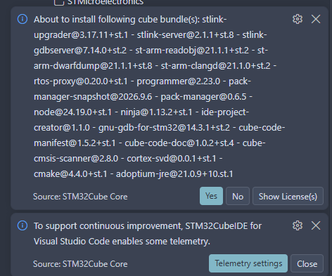
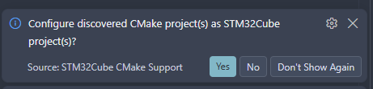
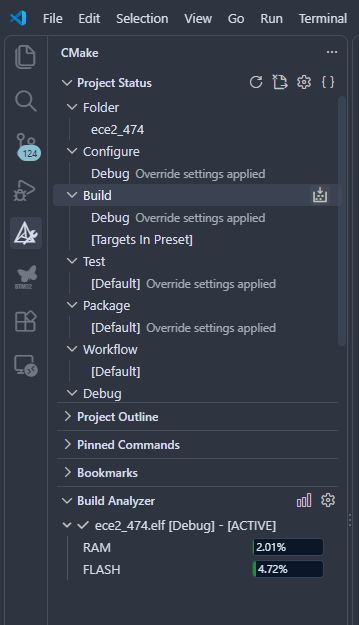

# LAB7 — STM32·FPGA SPI 통신

- 과목: 전자전기컴퓨터설계실험Ⅱ
- 학번 / 이름: 2023440129 / 조성현
- STM32 보드: NUCLEO-G474RE
- FPGA 보드: Combo II-DLD S75
- FPGA Part: xc7s75fgga484-1
- 실험 범위: STM32_3 과제8~12
- SPI 조건: Mode 0, 8비트, MSB 우선, SCK 1 MHz 이하
- 이번 실험은 한 방향씩 전송하며 MISO는 연결하지 않는다.

## 1. 과제별 구성과 증빙

| 과제 | 내용 | 사용하는 소스 | 사전 증빙 |
|---|---|---|---|
| 과제8 | MCU 송신 파형 확인 | [MCU 송신 코드](stm32_versions/spi_master/ece2_474_routine.c) | [코드·빌드](evidence/stm32/assignment8/) |
| 과제9 | MCU → MCU 수신 확인 | [MCU 송신 코드](stm32_versions/spi_master/ece2_474_routine.c), [MCU 수신 코드](stm32_versions/spi_slave/ece2_474_routine.c) | [수신 초기화·코드·빌드](evidence/stm32/assignment9/), [공통 송신 빌드](evidence/stm32/assignment8/) |
| 과제10 | MCU → FPGA 수신 구현 | [MCU 송신 코드](stm32_versions/spi_master/ece2_474_routine.c), [FPGA 수신 Top](fpga/spi/src/lab7_spi_rx_uart.v), [SPI 수신 모듈](fpga/spi/src/spi_slave_rx.v), [UART 모듈](fpga/spi/src/uart.v) | [수신 단독·UART 통합 검증](evidence/fpga/assignment10/), [공통 MCU 송신 빌드](evidence/stm32/assignment8/) |
| 과제11 | FPGA → MCU 송신 구현 | [FPGA 송신 Top](fpga/spi/src/lab7_spi_master.v), [SPI 송신 모듈](fpga/spi/src/spi_master_tx.v), [MCU 수신 코드](stm32_versions/spi_slave/ece2_474_routine.c) | [송신 검증](evidence/fpga/assignment11/), [공통 MCU 수신 빌드](evidence/stm32/assignment9/) |
| 과제12 | FPGA → FPGA 송수신 확인 | [FPGA 송신 Top](fpga/spi/src/lab7_spi_master.v), [SPI 송신 모듈](fpga/spi/src/spi_master_tx.v), [FPGA 수신 Top](fpga/spi/src/lab7_spi_rx_uart.v), [SPI 수신 모듈](fpga/spi/src/spi_slave_rx.v), [UART 모듈](fpga/spi/src/uart.v) | [연결 검증](evidence/fpga/assignment12/), [공통 송신 검증](evidence/fpga/assignment11/), [공통 수신 검증](evidence/fpga/assignment10/) |

공통 코드·빌드 자료는 한 곳에 보관하고 해당 과제에서 참조한다.
실제 보드 통신 결과는 과제별로 실험실에서 별도 확인한다.

## 2. STM32 코드 전환 방법

현재 실제 빌드 대상은 `Core/Src/ece2_474_routine.c`이며,
사전 준비의 마지막 상태는 SPI 슬레이브 수신 코드다.

| 역할 | 보관 파일 | 사용하는 과제 |
|---|---|---|
| 마스터 송신 | `stm32_versions/spi_master/ece2_474_routine.c` | 과제8·9·10 |
| 슬레이브 수신 | `stm32_versions/spi_slave/ece2_474_routine.c` | 과제9·11 |

실행할 역할의 보관 파일을 `Core/Src/ece2_474_routine.c`로 복사한 뒤 저장하고 빌드한다.
보관 폴더의 파일은 현재 CMake 빌드 목록에 포함되지 않는다.
실험실에서는 빌드 후 보드에 새 프로그램을 다운로드하고 실행을 재개한다.

송신 코드는 1초마다 기본값 0x55를 전송한다.
교안에 따라 0x55, 0xA5, 0x00, 0xFF로 값을 바꾸어 파형과 수신 결과를 비교한다.
송신 함수의 result=0만으로 상대의 수신 성공을 판단하지 않는다.

수신 코드는 PA4를 NSS 입력으로 설정하고, 받은 값을 VCP UART에 출력한다.
PC Serial Monitor는 9600 baud, 8N1, Text 표시를 사용한다.

## 3. FPGA 설계 파일과 Top

[전체 FPGA 소스](fpga/spi/src/)

| 파일 | 역할 |
|---|---|
| `spi_slave_rx.v` | 외부 입력 동기화, SCK 상승 에지 검출, 8비트 수신 |
| `lab7_spi_rx_uart.v` | SPI 수신값의 LED 반영 및 UART 문자열 출력 |
| `uart.v` | LAB6 UART 모듈 재사용. 이번 구성은 uart_tx 사용 |
| `spi_master_tx.v` | 한 바이트의 SPI 송신 파형 생성 |
| `lab7_spi_master.v` | 1초 간격 송신 요청과 완료 후 LED 갱신 |

| 역할 | Design Top | 필요한 설계 파일 | 적용 XDC |
|---|---|---|---|
| 수신 보드 | `lab7_spi_rx_uart` | `lab7_spi_rx_uart.v`, `spi_slave_rx.v`, `uart.v` | [수신 XDC](fpga/spi/constraints/lab7_spi_rx_uart.xdc) |
| 송신 보드 | `lab7_spi_master` | `lab7_spi_master.v`, `spi_master_tx.v` | [송신 XDC](fpga/spi/constraints/lab7_spi_master.xdc) |

TB는 시뮬레이션 전용이며 보드용 Design Top으로 선택하지 않는다.
두 XDC는 각각 대응하는 설계에 적용한다.

FPGA 송신 기본값은 0x55이며, 50 MHz 입력에서 SCK는 1 MHz다.
FPGA 수신 UART는 수신값을 두 자리 대문자 16진수와 CR·LF로 출력한다.
예를 들어 0xA5 수신 시 Text 화면에는 A5와 줄바꿈이 표시된다.
UART 출력 구성은 교안의 1초마다 한 바이트 전송을 기준으로 한다.

## 4. 사전 시뮬레이션 검증

[테스트벤치](fpga/spi/sim/)

| TB | 확인 내용 | 결과 |
|---|---|---|
| `tb_spi_slave_rx.sv` | 55·A5·00·FF·3C 수신, CS HIGH 중 무시, 미완성 전송 폐기와 재수신 | `LAB7_SPI_SLAVE_RX_PASS checks=5` |
| `tb_spi_rx_uart.sv` | 4바이트 수신, LED, 16진수 문자열과 CR·LF 총 16문자 | `LAB7_SPI_RX_UART_PASS bytes=4 chars=16` |
| `tb_spi_master.sv` | 55 송신 3회, 8개 상승 에지, SCK 주기, 반복 간격과 리셋 | `LAB7_SPI_MASTER_PASS frames=3` |
| `tb_spi_link.sv` | 송수신 Top 연결, SPI 2바이트와 UART 8문자, LED | `LAB7_SPI_LINK_PASS bytes=2 chars=8 UART=9600` |

### TB와 보드 설정의 차이

- SPI 수신 단독 TB: SCK 781.25 kHz.
- SPI→UART 통합 TB: UART 분주값을 16으로 줄여 검사.
- SPI 송신 TB: SCK는 1 MHz, 송신 간격은 40 μs로 축소.
- FPGA 연결 TB: 송신 간격은 6 ms로 축소하며 UART는 기본 9600 baud 사용.
- FPGA 보드용 송신 Top의 기본 송신 간격은 1초다.

축소된 TB 시간축을 실제 보드의 1초 간격으로 해석하지 않는다.
PASS는 각 TB가 검사한 디지털 동작 범위의 결과다.

## 5. 사전 검증 범위와 실험실 확인 항목

사전 검증은 STM32 빌드, FPGA RTL 시뮬레이션, 소스와 XDC 포트 대조까지다.
실제 보드 통신과 Vivado 구현 결과는 아직 확인하지 않았다.

실험실에서 다음을 확인한다.

- 과제8: MCU 송신의 SCK·MOSI·CS, 비트 순서와 주파수
- 과제9: MCU 수신 VCP UART 결과와 송수신 역할 교대
- 과제10: MCU 송신값과 FPGA UART 출력의 일치
- 과제11: FPGA 송신 파형과 MCU 수신 VCP UART 결과의 일치
- 과제12: 수신 FPGA UART 결과와 송수신 역할 교대
- 정확한 Part·Design Top·XDC, 합성·구현·DRC·타이밍 결과
- 실제 사용한 bitstream, 보드 다운로드·시연 자료와 SHA-256

실제 bitstream 생성·보드 다운로드는 실험실에서 진행하며,
사용한 bitstream과 보드 결과는 사후 자료로 정리한다.

## 6. 제공 코드와 작성 범위

- STM32 기본 프로젝트와 예제: 조교 제공 ece2_474 v1.1.0 기준.
- STM32 실습 코드는 docs/STM32_3.md의 송신·수신 예제를 적용했다.
- 기본 초기화·핀 정의·표준 입출력 연결 코드는 유지했다.
- FPGA SPI 송신·수신 RTL, 연결 Top, TB와 XDC는 LAB7용으로 작성했다.
- UART 모듈은 LAB6에서 사용한 uart.v를 재사용했다.
- 제출 기준 태그·커밋과 보고서 링크는 사전 자료 정리 후 추가한다.

---

# STM32 기초 실습

**실습 보드: NUCLEO-G474RE**

이 저장소를 내려받아 프로그램을 만들고 보드에서 실행한다. 현재 프로그램은 시작할 때 컴퓨터로 `Hello, World!`를 한 번 보낸다.

[실습 매뉴얼 · 4주 목차](docs/index.md) · [4주 실습 계획 PDF](docs/STM32_4week_plan.pdf)

**4주 실습에 필요한 매뉴얼은 모두 이 리포지토리에 정리되어 있다.** 매주 별도의 추가 매뉴얼은 제공하지 않으므로, 아래 목차에서 해당 주차의 문서를 확인하며 진행하면 된다. STM32_0~3은 하나의 매뉴얼을 주차별로 나눈 구성이다.

## 시작하기

1. VS Code의 확장 메뉴에서 **STM32CubeIDE for Visual Studio Code**를 설치한다.
2. 내려받은 폴더에서 [ece2_474.code-workspace](ece2_474.code-workspace)를 연다.
3. 아래 알림이 나오면 **Yes**를 누른다. 설치 목록에서 `gnu-tools-for-stm32`도 선택한다.

4. 왼쪽 **CMake** 메뉴에서 `Configure` 아래의 `Debug`를 선택한다. 설정이 끝나면 `Build` 오른쪽 버튼을 눌러 프로그램을 만든다.

5. 보드의 **JP5 점퍼가 `5V_STLK` 위치에 꽂혀 있는지 확인**하고, **ST-LINK USB 단자**를 컴퓨터에 연결한다.
6. VS Code 왼쪽 **실행 및 디버그** 메뉴에서 `STM32Cube: Launch ST-Link GDB Server`를 선택하고 **F5**를 누른다.
7. 코드의 `main` 위치에서 멈추면 **F5를 한 번 더** 눌러 실행한다.

## 컴퓨터에서 출력 확인하기

1. VS Code 확장 메뉴에서 **Serial Monitor**를 설치한다. 게시자는 **Microsoft**, 확장 이름은 `ms-vscode.vscode-serial-monitor`다.
2. **Terminal → New Terminal**을 누르고, 아래쪽 패널의 **Serial Monitor** 탭을 연다.
3. Windows **장치 관리자 → 포트(COM 및 LPT)**에서 보드의 포트 번호를 확인한다. 예: `COM5`.
4. Serial Monitor에서 아래 항목을 선택한다.

| 화면의 항목 | 선택할 값 |
|---|---|
| Monitor Mode | **Serial** |
| Port | 장치 관리자에서 확인한 보드의 COM 포트 |
| Baud rate | **9600** |
| View Mode | **Text** |

추가 설정의 `Data bits`는 **8**, `Parity`는 **None**, `Stop bits`는 **1**로 둔다.

5. **Start Monitoring**을 누른다.
6. 보드의 **RESET 버튼**을 누른다. VS Code에서 실행이 멈춰 있다면 F5를 눌러 계속한다.
7. Serial Monitor에 `Hello, World!`가 나오는지 확인한다. 메시지는 시작할 때 한 번만 나온다.

연결을 끝낼 때는 **Stop Monitoring**을 누른다.

## 핀별 용도

| 핀 | 용도 |
|---|---|
| PA0 | 범용 입력 · GPIO_IN_PULLUP_ece2 · 풀업, 하강 에지 인터럽트 |
| PA1 | 범용 입력 · GPIO_IN_PULLDOWN_ece2 · 풀다운, 상승 에지 인터럽트 |
| PA2 | `UART_PC_TX_ece2` · 컴퓨터로 데이터 보내기 · 보드 내부에서 USB에 연결됨 |
| PA3 | `UART_PC_RX_ece2` · 컴퓨터가 보낸 데이터 받기 · 보드 내부에서 USB에 연결됨 |
| PA5 | `LED_ece2` · 보드에 있는 LED 켜기·끄기 |
| PA6 | `SPI_MISO_ece2` · 외부 장치에서 데이터 받기 · SPI |
| PA7 | `SPI_MOSI_ece2` · 외부 장치로 데이터 보내기 · SPI |
| PA13 | 프로그램 다운로드·오류 확인용 연결 |
| PA14 | 프로그램 다운로드·오류 확인용 연결 |
| PB0 | 범용 출력 · GPIO_OUT1_ece2 · 초기 LOW |
| PB1 | 범용 출력 · GPIO_OUT2_ece2 · 초기 LOW |
| PB3 | `SPI_SCK_ece2` · 외부 장치와 데이터를 주고받을 때 타이밍 맞추기 · SPI |
| PB4 | `PWM_OUT_ece2` · 일정한 주기로 켜짐·꺼짐 신호 출력 · PWM |
| PB6 | `SPI_CS_ece2` · 통신할 외부 장치 선택 · SPI |
| PB8 | `I2C_SCL_ece2` · 외부 장치와 데이터를 주고받을 때 타이밍 맞추기 · I²C |
| PB9 | `I2C_SDA_ece2` · 외부 장치와 데이터 주고받기 · I²C |
| PC10 | `UART_FPGA_TX_ece2` · FPGA로 데이터 보내기 · FPGA의 받는 핀에 연결 |
| PC11 | `UART_FPGA_RX_ece2` · FPGA가 보낸 데이터 받기 · FPGA의 보내는 핀에 연결 |
| PC13 | `BUTTON_ece2` · 보드에 있는 사용자 버튼 입력 |
| GND | FPGA·외부 장치의 GND와 연결 |

컴퓨터 연결과 FPGA 연결은 모두 **9600**으로 사용한다. 외부 장치 연결은 **3.3 V 기준**이다. FPGA 쪽 핀은 해당 실습에서 지정한다.

시간을 재는 기능은 100 ms마다 동작하도록 준비했다. PB4는 1초에 1000번 반복하며, 한 주기의 절반 동안 켜진다. 이 신호는 PA5의 내장 LED와 별개다. 버튼·통신·시간 제어의 실제 동작은 각 주차에 코드를 추가한다.

범용 입력은 인터럽트가 켜져 있어도 HAL_GPIO_ReadPin으로 현재 상태를 읽을 수 있다. PA0는 기본 HIGH이며 GND로 연결할 때, PA1은 기본 LOW이며 3.3 V로 연결할 때 인터럽트가 발생한다. 새 핀의 이름은 용도 뒤에 ece2를 붙였다. 코드에서는 main.h에 생성된 이름에 _Pin과 _GPIO_Port가 붙은 매크로를 사용한다.

## 인터럽트 우선순위

여러 요청이 겹치면 숫자가 작은 쪽을 먼저 처리한다. 높은 우선순위 요청은 낮은 우선순위 처리 도중에도 먼저 처리할 수 있다.

| 기능 | 우선순위 |
|---|---:|
| TIM6 · 주기 타이머 | 4 |
| UART3 · FPGA 통신 | 5 |
| UART2 · 컴퓨터 통신 | 6 |
| PC13 · 버튼 | 7 |
| PA0 · 범용 풀업 입력 | 8 |
| PA1 · 범용 풀다운 입력 | 9 |
| 기본 시간 관리 | 15 |

## 제공 코드 안내

핀·클록·주변장치를 준비하는 기본 코드는 **CubeMX 설정에서 자동 생성한 코드**다. 학생은 CubeMX에서 다시 생성하지 않고 제공된 파일을 그대로 사용한다.

| 파일 | 만든 방식 |
|---|---|
| `main.c`의 초기화 코드 | CubeMX 자동 생성 |
| `stm32g4xx_hal_msp.c`, `stm32g4xx_it.c` | CubeMX 자동 생성 |
| `syscalls.c`, `sysmem.c` | CubeMX 자동 생성 |
| `Drivers/` | ST와 Arm이 제공한 기본 코드 |
| `ece2_474_stdio.c`, `ece2_474_routine.c`, `ece2_474.h` | 별도로 작성한 실습용 코드 |

`printf`, `getchar`, `fgets`, `scanf`를 컴퓨터와 연결하는 코드는 [ece2_474_stdio.c](Core/Src/ece2_474_stdio.c)에 있다. 학생은 이 연결 코드를 그대로 사용하고 실습 동작을 작성하면 된다.

학생은 ece2_474_routine.c에서 실습 동작을 작성한다. main.c는 아래 함수를 호출하도록 준비되어 있다.

| 함수 | 호출 시점 | 작성할 내용 |
|---|---|---|
| `ece2_474_init()` | 주변장치 초기화 후 한 번 | 타이머·PWM 시작 등 |
| `polling_routine()` | 메인 루프에서 반복 | 입력 확인과 반복 동작 |
| 인터럽트 실습 함수 | 해당 이벤트 발생 시 | 버튼·통신·타이머 이벤트 처리 |

새 예제나 다른 주차로 넘어갈 때는 [예제 시작과 전환](docs/index.md#예제-시작과-전환)에 따라 이전 코드를 정리한다. 수정 후 Build만 하지 말고 디버깅을 종료한 뒤 F5로 다시 다운로드한다.

## 수정할 파일

- [ece2_474_stdio.c](Core/Src/ece2_474_stdio.c): 표준 입출력 연결 코드
- [ece2_474_routine.c](Core/Src/ece2_474_routine.c): 처음에 할 일·반복할 일·인터럽트 동작 작성
- [ece2_474.h](Core/Inc/ece2_474.h): 함께 사용할 함수·주변장치 변수 선언
- [main.c](Core/Src/main.c): 기본 초기화와 실습 함수 호출 · 제공된 코드 사용

## 참고 자료

- [Microsoft Serial Monitor 설치](https://marketplace.visualstudio.com/items?itemName=ms-vscode.vscode-serial-monitor)

- [VS Code 설치 안내](https://www.st.com/resource/en/user_manual/um3512-stm32cubeide-for-visual-studio-code-installation-guide-stmicroelectronics.pdf)
- [필요한 도구 설치 안내](https://dev.st.com/stm32cube-docs/stm32cubeide-vscode/latest/en/docs/markup/basic_concepts/bundles.html)
- [프로그램 만들기·실행하기](https://dev.st.com/stm32cube-docs/stm32cubeide-vscode/latest/en/index.html)
- [보드 설명서·핀 위치](https://www.st.com/resource/en/user_manual/um2505-getting-started-with-stm32g4-series-nucleo64-board-stmicroelectronics.pdf)
- [수업 자료·보고서 안내](https://github.com/Glaysia/ece2_26_2_2)
